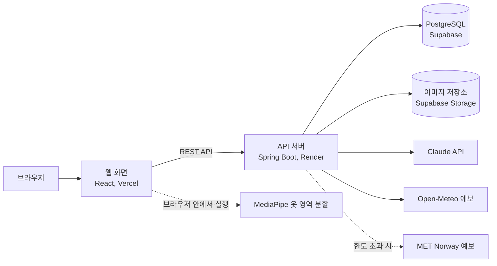

# modi

일정·날씨·세탁 상태를 함께 읽고 일주일 코디를 계획하는 옷장 에이전트이다.

## 바로 써 보기

| 구분 | 주소 |
|---|---|
| 웹 | https://modi-brown.vercel.app |
| API 문서 (Swagger UI) | https://modi-api-ch95.onrender.com/swagger-ui.html |

- 로그인 없이 데모 사용자의 옷장(옷 17벌)과 이번 주 일정으로 바로 써 볼 수 있다. 모든 접속자가 같은 데모 옷장을 함께 쓴다.
- API 서버는 무료 인스턴스라 오래 요청이 없으면 잠든다. 첫 접속이 1~3분 걸리면 서버가 깨어나는 중이다.

## MVP

### 옷장

- **옷 등록:** 옷 사진을 올리면 AI가 종류·색·스타일·두께·격식을 읽어 등록 정보를 채운다. 사용자는 확인하고 고치기만 하면 된다.
- **옷 상태 관리:** 옷마다 입을 수 있음·세탁·건조·수선 상태를 관리한다. 입은 횟수를 세어 세탁할 때가 되면 알려 준다.
- **추워요/더워요 피드백:** 입고 나간 날의 체감을 남기면 다음 추천부터 더 따뜻하게 또는 더 가볍게 고른다.

### 캘린더 기반 코디 추천

- **일정 분석:** 면접·결혼식·등산 같은 일정을 읽어 그날 필요한 격식과 피할 색을 정한다. 결혼식이면 흰색을 피하는 식이다.
- **주간 코디:** 일정과 날씨, 옷 상태를 함께 보고 일주일 코디를 미리 짠다.
- **세탁 역산:** 중요한 날 입을 옷이 세탁 중이면 언제까지 세탁을 시작해야 그날 마르는지 알려 준다.
- **시간대별 레이어링:** 아침과 낮의 기온 차가 8℃ 이상이면 벗을 수 있는 겉옷을 함께 추천한다.
- **날씨 반영:** 기온·체감온도·강수를 반영하고, 맑음·흐림·안개·비·눈·뇌우 6가지 날씨 상태를 제공한다.

### 옷 평가

- 고른 조합을 날씨·상황·색 조합·세탁 상태 4가지로 채점하고, 바꾸면 좋을 옷을 내 옷장에서 제안한다.

### 비슷한 옷 보유 검사

- 사려는 옷의 사진을 올리면 내 옷장에 거의 같은 옷이나 비슷한 옷이 있는지 알려 준다. 그 옷을 사면 함께 입을 수 있는 내 옷이 몇 벌인지도 보여 준다.

### 가성비 옷 찾기

- **쇼핑몰 바로가기:** 사진 속 옷의 검색어를 만들어 무신사·지그재그·29CM·W컨셉의 낮은 가격순 결과와 11번가 인기순 결과로 바로 연결한다.
- **AI 제품 추천:** AI가 웹을 검색해 비슷하면서 더 싼 실제 제품을 최대 2개 찾아 이름·가격·쇼핑몰·추천 이유와 함께 보여 준다. 가격은 검색 시점 기준이다.

### 살까 말까

- 코디 사진 한 장을 올리면 겉옷, 상의, 하의, 신발을 부위별 카드로 나눠 상품명과 특징을 보여 준다. 옷장에 거의 같은 옷이 있으면 카드에 경고하고, 카드마다 더 싼 제품을 찾을 수 있다.
- 카드 사진은 브라우저에서 MediaPipe로 사람의 얼굴과 피부를 지우고 옷만 남긴다. 사진을 서버로 보내지 않는다.

### 아바타 옷 입히기

- 오늘 코디를 캐릭터에 입혀 보여 준다. AI가 옷 사진을 보고 캐릭터가 입을 옷을 SVG로 한 번 그리고, 그림은 저장해 다시 쓴다.

### 믿을 수 있는 추천

- AI가 확신이 낮거나 실패하면 그 사실을 응답에 표시하고, 규칙 기반 결과나 쇼핑몰 바로가기로 대신한다.
- 일정 속 이름·전화번호·주소는 가린 뒤 분석하고, 사진의 위치 정보는 지운다.

## 기술 스택

Java 21, Spring Boot 4.2, Spring AI 2.1(Claude 기본, GPT·Gemini 전환 가능), PostgreSQL 17, S3 호환 저장소, Open-Meteo

## 구조



### 설계 원칙

1. 코디 선택, 주간 배정, 세탁 마감 계산, 옷장 유사도 비교는 규칙 엔진이 한다. AI는 사진과 일정 글에서 속성을 읽고, 설명 문장을 쓰고, 웹에서 제품을 찾는 데만 쓴다.
2. AI 호출이 실패하면 일정 분석은 키워드 규칙, 코디 설명은 규칙 문장, 옷 평가는 기본 색 점수, 제품 찾기는 쇼핑몰 검색 링크로 대신한다.
3. AI가 준 값은 서버에서 다시 정리한다. 정해진 어휘와 범위 밖의 값은 버리고, 제품 주소는 실제 웹 검색 결과에 있는지 확인하고, SVG는 실행 가능한 요소가 있으면 버린다.
4. 일정 저장과 주간 계획은 규칙 결과로 먼저 응답하고, AI 결과는 백그라운드에서 만들어 다음 조회 때 바꿔 넣는다.

### AI 호출 지점

| 기능 | 클래스 | 모델 | 실패 시 |
|---|---|---|---|
| 옷 사진 분석 | `ClothingVisionAnalyzer` | Opus 5.5 | 빈 양식, 직접 입력 |
| 일정 분석 | `EventAnalyzer` | Opus 5.5 | 키워드 규칙 |
| 코디 설명 | `PlanExplainer` | Opus 5.5 | 규칙 문장 |
| 옷 평가 총평 | `EvaluationNarrator` | Opus 5.5 | 기본 색 점수 |
| 코디 사진 부위별 분석 | `LookService` | Opus 5.5 | 빈 카드 목록 |
| 가성비 제품 찾기 | `ProductFinder` | Sonnet 5.5 + 웹 검색 | 쇼핑몰 검색 링크 |
| 아바타 옷 그림 | `AvatarPaintService` | Opus 5.5 | 옷 색으로 칠한 기본 그림 |

프롬프트는 `backend/src/main/resources/prompts/`에 기능별로 있다.

### 백엔드 패키지 (`backend/src/main/java/com/modi`)

| 패키지 | 역할 |
|---|---|
| `ai` | ChatClient 설정, 옷 사진 분석, AI 사용량 기록 |
| `avatar` | 아바타 옷 그림 생성과 SVG 검사 |
| `closet` | 옷장 CRUD, 상태와 세탁, 비슷한 옷 보유 검사(`similar`) |
| `common` | 응답 형식, 오류 처리, 캐시, 요청 제한, 사용자 식별 |
| `demo` | 데모 옷장과 일정 시드 |
| `outfit` | 옷 조합 평가 |
| `plan` | 주간 코디 계획, 하루 재추천, 세탁 역산, 코디 설명 |
| `schedule` | 일정 저장과 동기화, 개인정보 마스킹, 일정 분석 |
| `shopping` | 쇼핑몰 검색 링크, 가성비 제품 찾기(`find`), 살까 말까(`look`) |
| `storage` | 이미지 정규화(EXIF 제거), S3 저장소 |
| `weather` | 예보 조회와 출처 전환, 체감온도와 보온 규칙 |
| `wear` | 착용 기록과 추워요/더워요 피드백 |

웹 화면(`frontend/src`)은 `pages`에 오늘, 주간, 옷장, 살까 말까 4개 화면이 있고, `api/local`에 서버 없이 도는 브라우저용 규칙 엔진(mock 모드)이 있다.

## 실행

```bash
cp .env.example .env            # ANTHROPIC_API_KEY 입력
docker compose up -d            # PostgreSQL, 이미지 저장소, 데모 사진 업로드
cd backend && set -a && . ../.env && set +a && ./gradlew bootRun
```

- 헬스 체크: `curl localhost:8080/actuator/health`
- API 문서 화면: `http://localhost:8080/swagger-ui.html`
- 테스트: `cd backend && ./gradlew test`

처음 실행하면 데모 옷장 17벌과 다음 주 일정 6건이 들어간다(`DEMO_SEED=false`로 끌 수 있다).

## API

전체 명세는 [`docs/openapi.yaml`](docs/openapi.yaml)(OpenAPI 3.1)에 있다.

- 모든 응답은 `{ "success": true, "data": ..., "error": null }` 형태다.
- `X-User-Id` 헤더(UUID)로 사용자를 구분한다. 헤더가 없으면 데모 사용자로 처리하고, 처음 보는 UUID는 새 사용자로 만든다.
- AI를 호출하는 API는 IP당 시간 60회까지 호출할 수 있고, AI 제품 추천은 별도로 시간 10회까지다. 넘으면 429를 반환한다.

### 옷장

| 메서드 | 경로 | 설명 |
|---|---|---|
| POST | `/api/clothes/analyze` | 옷 사진(multipart `image`)을 분석해 등록 정보 초안을 돌려준다 |
| POST | `/api/clothes` | 옷을 등록한다 |
| GET | `/api/clothes` | 내 옷 목록을 조회한다 |
| GET | `/api/clothes/{id}` | 옷 하나를 조회한다 |
| PATCH | `/api/clothes/{id}` | 옷 정보를 수정한다 |
| DELETE | `/api/clothes/{id}` | 옷을 삭제한다 |
| PATCH | `/api/clothes/{id}/status` | 상태를 바꾼다(입을 수 있음·세탁·건조·수선) |
| POST | `/api/laundry` | 여러 벌을 한 번에 세탁 시작으로 바꾼다 |
| POST | `/api/clothes/similar-check` | 사려는 옷 사진을 내 옷장과 비교한다 |
| GET | `/api/images/{key}` | 저장된 옷 이미지를 내려받는다 |
| GET | `/api/clothes/{id}/avatar-paint` | 캐릭터(`model`)가 입을 옷 그림을 SVG로 돌려준다. 옷마다 한 번 그리고 저장한다 |

### 착용 기록

| 메서드 | 경로 | 설명 |
|---|---|---|
| POST | `/api/wear-logs` | 입은 옷과 추워요/더워요 피드백을 기록한다 |
| GET | `/api/wear-logs` | 착용 기록을 조회한다 |
| DELETE | `/api/wear-logs/{id}` | 착용 기록을 취소한다. 입은 횟수와 추워요/더워요 보정도 되돌린다 |

### 날씨

| 메서드 | 경로 | 설명 |
|---|---|---|
| GET | `/api/weather` | 현재·시간별·7일 예보와 보온 단계를 돌려준다(`lat`, `lon`, 생략 시 서울) |

### 일정

| 메서드 | 경로 | 설명 |
|---|---|---|
| POST | `/api/events/mask-preview` | 일정 텍스트에서 가려질 개인정보를 미리 보여 준다 |
| PUT | `/api/events/sync` | 캘린더 일정을 기간 단위로 동기화하고 바뀐 일정만 분석한다 |
| POST | `/api/events` | 일정 하나를 직접 추가한다 |
| GET | `/api/events` | 기간 내 일정과 분석 결과를 조회한다 |
| DELETE | `/api/events/{id}` | 일정을 삭제한다 |

### 코디 추천·평가

| 메서드 | 경로 | 설명 |
|---|---|---|
| GET | `/api/plans/week` | 7일 코디, 세탁 할 일, 충돌을 돌려준다(`start` 필수) |
| POST | `/api/plans/day` | 하루 코디를 다시 추천한다 |
| POST | `/api/outfits/evaluate` | 고른 조합을 채점하고 바꿀 옷을 제안한다 |

### 가성비 옷 찾기

| 메서드 | 경로 | 설명 |
|---|---|---|
| POST | `/api/shopping/similar` | 옷 사진으로 검색어와 쇼핑몰 바로가기 링크 5개를 돌려준다 |
| GET | `/api/shopping/links` | 고친 검색어로 링크만 다시 만든다(`query`, 선택 `category`). AI를 호출하지 않는다 |
| POST | `/api/shopping/look` | 코디 사진(`image`)을 부위별 카드로 나누고 옷장에 거의 같은 옷이 있으면 함께 알려 준다 |
| POST | `/api/shopping/look/find` | 카드 하나의 더 싼 제품을 찾는다. 빈손이면 검색어(`queries`, 줄바꿈 구분)를 바꿔 최대 3번까지 다시 찾는다 |
| POST | `/api/shopping/find` | 사진(`image`)이나 텍스트(`text`)로 더 싼 실제 제품을 최대 2개 찾는다. 20~30초 걸리며, 실패해도 쇼핑몰 링크를 함께 돌려준다 |

### 운영

| 메서드 | 경로 | 설명 |
|---|---|---|
| GET | `/api/ai-usage` | 서버가 켜진 뒤 기능별 AI 호출 횟수와 입력, 출력 토큰을 돌려준다 |

## 환경 변수

| 이름 | 기본값 | 설명 |
|---|---|---|
| `AI_PROVIDER` | `anthropic` | `anthropic`, `openai`, `google-genai` 중 하나 |
| `ANTHROPIC_API_KEY` | 없음 | Claude API 키 |
| `ANTHROPIC_MODEL` | `claude-opus-5-5` | 기본 모델 |
| `SHOPPING_FIND_MODEL` | `claude-sonnet-5-5` | AI 제품 추천에만 쓸 모델. 빈 값으로 두면 `ANTHROPIC_MODEL`을 쓴다 |
| `OPENAI_API_KEY`, `GEMINI_API_KEY` | 없음 | 다른 AI 공급자를 쓸 때 입력한다 |
| `DB_URL`, `DB_USERNAME`, `DB_PASSWORD` | 로컬 PostgreSQL | 데이터베이스 접속 정보 |
| `DB_POOL_SIZE` | `5` | 데이터베이스 최대 연결 수 |
| `STORAGE_ENDPOINT`, `STORAGE_REGION`, `STORAGE_BUCKET`, `STORAGE_ACCESS_KEY`, `STORAGE_SECRET_KEY` | 로컬 저장소 | S3 호환 이미지 저장소 |
| `CORS_ALLOWED_ORIGINS` | `http://localhost:5173` | API 호출을 허용할 웹 주소. 쉼표로 여러 개를 쓰고, `https://modi-*.vercel.app` 같은 패턴도 쓸 수 있다 |
| `JAVA_OPTS` | 메모리 512MB 기준 값 | 컨테이너에서 실행할 때의 JVM 옵션 |
| `AI_RATE_LIMIT_PER_HOUR` | `60` | AI 호출 API의 IP당 시간 한도 |
| `FIND_RATE_LIMIT_PER_HOUR` | `10` | AI 제품 추천의 IP당 시간 한도 |
| `DEMO_SEED` | `true` | 데모 데이터 시드 여부 |
| `PORT` | `8080` | 서버 포트 |

웹 화면은 빌드할 때 아래 값을 읽는다.

| 이름 | 개발 서버 기본값 | 배포 빌드 기본값 | 설명 |
|---|---|---|---|
| `VITE_API_BASE_URL` | `http://localhost:8080` | `http://localhost:8080` | API 서버 주소. 배포할 때는 반드시 넣는다 |
| `VITE_API_MODE` | `mock` | `real` | `mock`은 API 서버 없이 브라우저 안의 데모 데이터로 동작한다 |
| `VITE_SHARED_DEMO_USER` | `false` | `true` | `true`면 모든 접속자가 데모 사용자의 옷장(17벌)을 함께 쓰고, `false`면 브라우저마다 빈 옷장에서 시작한다 |

## 배포

웹 화면은 Vercel, API 서버는 Render, 데이터베이스와 이미지 저장소는 Supabase를 기준으로 한다.

1. **Supabase**
   - 프로젝트를 만든다. 리전은 한국에서 가까운 서울(`ap-northeast-2`)이나 도쿄(`ap-northeast-1`)를 고르고, `STORAGE_REGION`에 같은 값을 넣는다.
   - Storage에서 비공개 버킷 `modi`를 만들고, Storage > S3 Configuration에서 액세스 키를 발급한다.
   - 데이터베이스는 Connect > Session pooler의 접속 정보를 쓴다. 직접 연결 주소는 IPv6 전용이라 Render에서 접속하지 못한다.
2. **Render**
   - New > Blueprint에서 이 저장소를 고르면 `render.yaml`에 적힌 API 서버가 만들어진다.
   - 비밀값은 대시보드에서 입력한다.

   | 이름 | 값 |
   |---|---|
   | `DB_URL` | `jdbc:postgresql://<pooler 주소>:5432/postgres?sslmode=require` |
   | `DB_USERNAME` | `postgres.<project-ref>` |
   | `STORAGE_ENDPOINT` | `https://<project-ref>.storage.supabase.co/storage/v1/s3` |
   | `CORS_ALLOWED_ORIGINS` | Vercel 배포 주소 |

   테이블은 서버가 처음 뜰 때 Flyway가 만든다.
3. **Vercel**
   - Root Directory를 `frontend`로 지정한다.
   - 환경 변수 `VITE_API_BASE_URL`에 Render 서버 주소를 넣는다.
   - 다른 경로로 바로 들어와도 화면이 열리도록 `frontend/vercel.json`이 모든 경로를 `index.html`로 보낸다.

Render 무료 인스턴스는 15분 동안 요청이 없으면 잠든다. 메모리 512MB, CPU 0.1로 제한한 컨테이너에서 서버 기동에 164초가 걸렸고 메모리는 379MB를 썼다. 시연 전에는 외부 모니터링 서비스로 `/actuator/health`를 10분마다 호출해 깨워 둔다.
